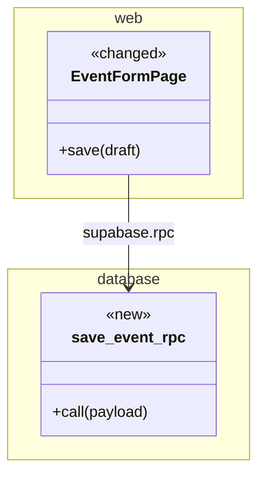
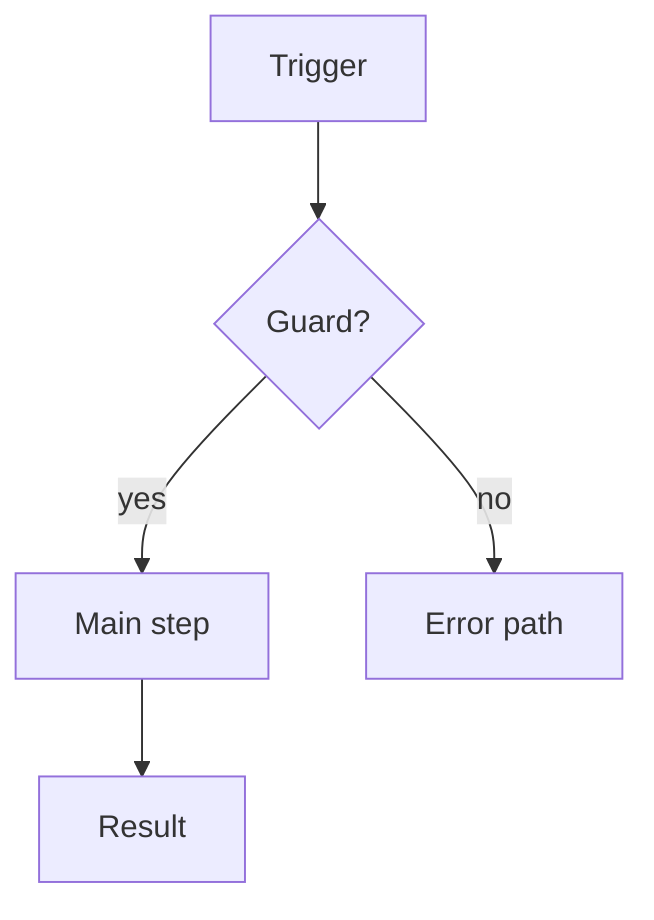
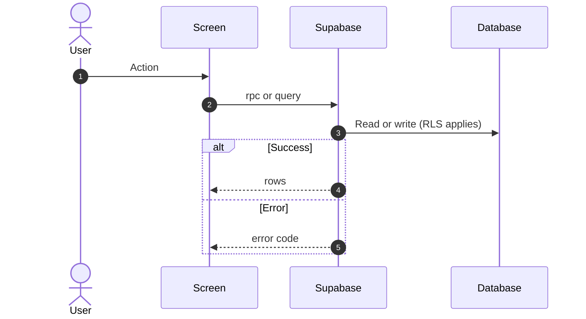

# Plan Doc template

Title: **Plan: <task in a few plain words>**

The Doc has two parts. Sections 1 to 5 are for the person: plain words, no jargon, no file
names, no code. Sections 6 to 12 are the high-level design for the engineers and for the
sub-agents that build it: technical words and paths are allowed, written plainly.

Writing rules, for every section:

- Short sentences. One idea each.
- No filler, no hedging, no empty adjectives ("robust", "seamless", "simple").
- Say each thing once. Do not restate another section; point to it ("see F2").
- An empty section is one line: "None".
- Diagrams are Mermaid, always included, with one caption line above each.

## 1. In one sentence

What is being asked, in one sentence the person would agree with.

## 2. What you get

3 to 6 bullets. Each is an outcome someone can see or use, not a piece of work.

## 3. What it looks like

The preview link, with one line on what to look at. Or: "Nothing changes on screen."

## 4. Not included

What someone might expect that this plan does not do.

## 5. How you'll check it

A numbered checklist the person can follow: what to click and what they should see. For
work with nothing on screen, what you will check and how you will show the result. The
final report marks each line done or not done.

## 6. Current state

What exists today that this work changes or builds on.

| Kind                                                          | Name   | Path             | What it does today |
| ------------------------------------------------------------- | ------ | ---------------- | ------------------ |
| [Page / Component / Hook / Lib / Table / RPC / Edge function] | [Name] | [path/file:line] | [One line]         |

## 7. Design overview

3 to 6 sentences: the approach, and which layers change.

**Flows**

| ID  | Flow            | Actor and trigger                                 | Tasks  |
| --- | --------------- | ------------------------------------------------- | ------ |
| F1  | [Who does what] | [The click, request, job or event that starts it] | T1, T2 |

**Key decisions**

1. [X], because [Y]. Rejected: [Z, and why].

## 8. Class diagram

One diagram for the whole plan: new and changed components, hooks, helpers, tables and
functions, plus the existing ones they attach to. Mark each `<<new>>` or `<<changed>>`. One
namespace per layer touched (web, database, edge functions), caller first.

## 9. Flows

One subsection per flow, same IDs and titles as the table in 7. Each has a flowchart
(guards, branches, error exits), then a sequence diagram (screen, Supabase, edge function
or outside service), with the error path in `alt` / `else`.

### F1 · [Who does what]

## 10. Changes

- **Data:** tables, columns, RLS policies, RPCs, migrations. Or "None".
- **Edge functions:** functions added or changed, and their payloads. Or "None".
- **Screens:** pages and components added or changed. Or "None".
- **Config:** settings, secrets, flags. Or "None".
- **Phone apps:** what the Android and iPhone apps need to keep working (they read the same
  database). Or "None".

## 11. Pull requests

Cut the work into pull requests up front. There is no file limit; cut where a reviewer can
read and check one thing at a time (often: database first, then screens). Later pull requests
stack on the earlier one. One block per pull request, self-contained: the coordinator passes
it, as is, to the yahpaz-build workflow.

### PR1 · [What it delivers, one line]

- **Files:** [paths it creates or changes]
- **Risk:** normal, or high (database, migrations, RLS, sign-in, security, or big). High adds
  the Fable final review and Codex effort xhigh.
- **Tests first:** unit tests (vitest, `src/**/*.test.ts` next to the code: file, the
  behaviour each checks, and what code bug would make it fail). Logic moves into `src/lib/`
  so it can be tested. Written and approved before the build.
- **Live steps:** what must happen for this to go live besides the merge (a migration added
  to the edge-function deploy list, a secret, a phone app release). Or "None: the merge
  deploys it".
- **Tasks:** one T block each. Tasks in one PR never share a file, so independent ones can be
  built at the same time.

#### T1 · [What it does, one line]

- **Does:** [Two or three sentences.]
- **Files:** [paths it creates or changes]
- **Depends on:** [T-ids in this PR, or None]
- **Implements:** [F-ids]

## 12. Risks and open questions

Each risk with what limits it. Each question with a suggested answer. Or "None".
